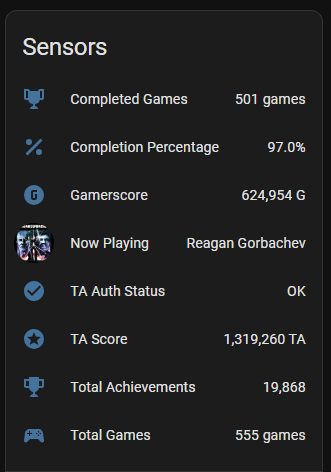
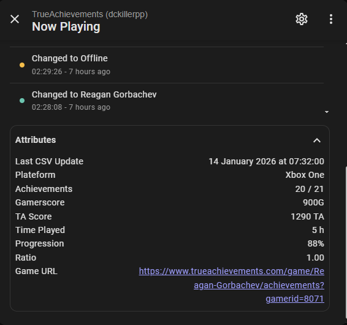
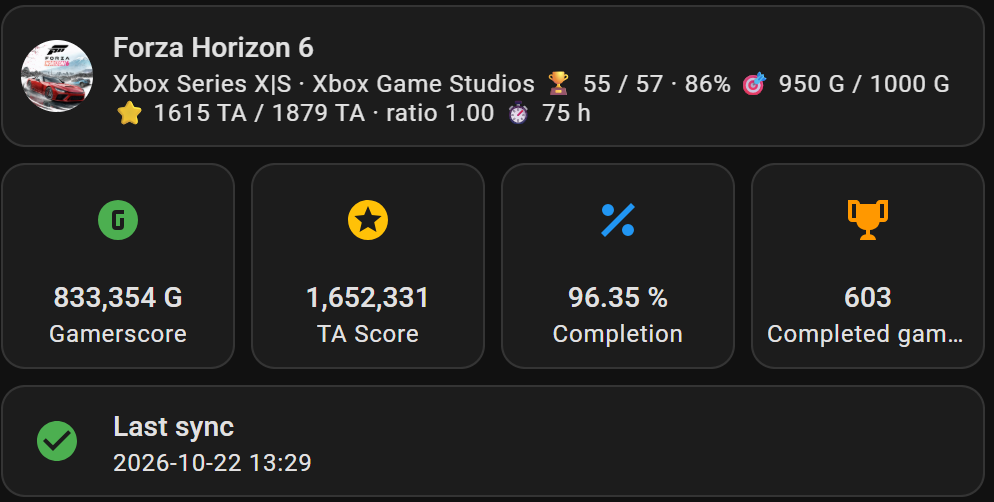
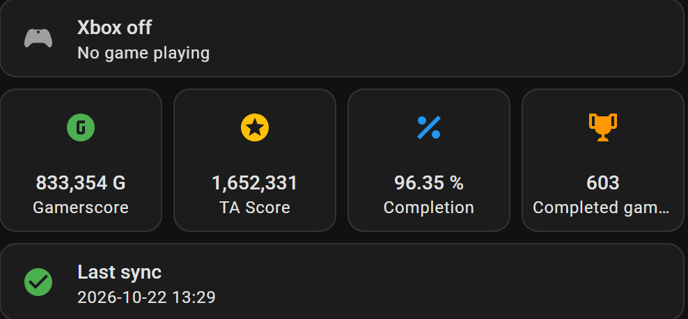

# TrueAchievements for Home Assistant

> [!IMPORTANT] > **This integration requires a TrueAchievements PRO account.**
> Data is retrieved via the "CSV Export" feature, which is a premium feature exclusive to Pro members on the TrueAchievements website.

[](https://github.com/dckiller51/trueachievements/releases)
[](https://github.com/dckiller51/trueachievements/releases)
[](https://github.com/dckiller51/trueachievements/commits/main)
[](https://github.com/hacs)
[](https://ko-fi.com/dckiller)

## Overview

Bring your Xbox accomplishments into Home Assistant! This integration synchronizes your **TrueAchievements** statistics (Gamerscore, TA Score, Completion) and provides a dynamic "Now Playing" sensor that reflects your current game progress in real-time.

## How it Works

The integration utilizes the TrueAchievements CSV export feature to fetch your data. TrueAchievements is protected by Cloudflare, which blocks Home Assistant from downloading the file for long, so the **recommended setup** is to let **Firefox, where you are signed in, send the CSV to Home Assistant** (see [Recommended setup](#recommended-setup-firefox-extension)). When linked with a Home Assistant Xbox sensor, a refresh is triggered whenever you switch games.

**Key Features:**

- **Global Stats:** Track your total Gamerscore, TrueAchievement Score, and overall completion percentage.
- **Dynamic "Now Playing":** See the current game's title, platform, achievement progress, and TA ratio.
- **Privacy Focused:** All CSV processing is done locally on your Home Assistant instance.
- **Multi-language:** Full support for English and French.

## Prerequisites

1. **TrueAchievements PRO Account:** You must have an active **Pro** subscription. This is required to access the `download.aspx?type=gamecollection` export used by this integration.
2. **GamerID:** Your numeric TrueAchievements ID (see the FAQ).
3. **Firefox** (desktop or Android) signed in to TrueAchievements, for the recommended setup. A session cookie (**GamerToken**) is only needed if you do not use it.
4. **Xbox Integration (Optional but Recommended):** To enable instant "Now Playing" updates, you should have the official Home Assistant Xbox integration installed.

## Installation

### Via HACS (Recommended)

1. Open **HACS** in Home Assistant.
2. Search for **"TrueAchievements"** using the top search bar.
3. Click on the **TrueAchievements** integration that appears.
4. Click **Download** in the bottom right corner.
5. **Restart** Home Assistant.

### Manual Installation

1. Download the latest release.
2. Copy the `custom_components/trueachievements` folder into your `config/custom_components` directory.
3. Restart Home Assistant.

## Configuration

1. Go to **Settings** -> **Devices & Services**.
2. Click **Add Integration** and search for **TrueAchievements**.
3. **Setup fields:**
   - **Gamertag:** Your Xbox name.
   - **GamerID:** Your unique numeric ID from TrueAchievements.
   - **GamerToken:** (Optional) Your full session cookie value. Leave it empty with the recommended setup.
   - **User-Agent:** (Optional) The User-Agent of the browser you copied the cookie from.
   - **Local file only:** Enable it with the recommended setup: Home Assistant then never downloads anything, it only uses the CSV sent by Firefox.
   - **Now Playing Entity:** Select your Xbox `sensor.xbox_now_playing`.
   - **Excluded Apps:** (Optional) List apps like "YouTube" or "Netflix" to ignore them in stats.

## Recommended setup: Firefox extension

1. Add the integration (above) and tick **Local file only**.
2. Open the integration **Configure** (options) page: it shows your private **upload address** (`/api/webhook/...`). Keep it secret, anyone on your network who knows it can replace your CSV.
3. Install **TrueAchievements Sync** from [Mozilla Add-ons](https://addons.mozilla.org/addon/3100079/) in Firefox (desktop or Android) and sign in to [trueachievements.com](https://www.trueachievements.com) in that browser.
4. Open the extension settings and fill:
   - the **upload address**: the address of your Home Assistant followed by the path from step 2, for example `http://192.168.1.10:8123/api/webhook/...` (prefer the IP address to a `.local` name on Android),
   - your **gamertag** and your **GamerID**.
5. Press **Sync now**. The status shows whether the CSV reached Home Assistant.

The extension synchronises when Firefox starts and nothing runs in the background afterwards. Open its settings to check the last result and press **Sync now** if it failed. If the server answers with an empty file, it reloads a TrueAchievements tab (or opens your profile in a background tab) and tries again once. Home Assistant keeps the last CSV it received, so nothing breaks while Firefox is closed: the statistics are simply not refreshed.

> [!NOTE]
> The extension only talks to trueachievements.com and to the upload address you enter. It sends nothing to any third party.

## Sensors Created

| Sensor                 | Description                             | Key Attributes / Info                   |
| :--------------------- | :-------------------------------------- | :-------------------------------------- |
| **Gamerscore**         | Your total Gamerscore (G).              | Total GS accumulated.                   |
| **TA Score**           | Your total TrueAchievement score.       | Total TA points.                        |
| **Completion %**       | Global achievement completion rate.     | Percentage based on total achievements. |
| **Total Games**        | Total number of games started.          | Excludes apps (if configured).          |
| **Completed Games**    | Games finished with 100% achievements.  | Games with all achievements unlocked.   |
| **Total Achievements** | Total individual achievements unlocked. | All games combined.                     |
| **Lost Completions**   | Games that were 100% but no longer are. | `games`, `game_names` (see below).      |
| **Now Playing**        | Current game name and details.          | **See detailed attributes below.**      |
| **Auth Status**        | Binary sensor for session validity.     | `ON` if token needs update.             |

---

### 🏆 Lost Completions

When new achievements are added to a game you had completed (usually with a DLC), your **Completed Games** count drops. The **Lost Completions** sensor (`sensor.trueachievements_<gamertag>_lost_completions`) tells you which games are concerned:

- **State:** the number of games that were completed at 100% and no longer are.
- **`games`:** one entry per game with `name`, `platform`, `achievements` (e.g. `120 / 135`), `missing_achievements`, `gamerscore` and `game_url`.
- **`game_names`:** just the names, handy for a notification.

A game leaves the list as soon as it is completed again. The integration remembers every game it has seen at 100%, starting from its first update: a completion lost before this version was installed cannot be detected.

**Notification:** like for unmatched games, Home Assistant shows a notification for each game that is no longer at 100%, with its progress and a link to the game on TrueAchievements. It disappears automatically once the game is completed again. You can turn it off with the **Notify when a game is no longer completed at 100%** option.

To be notified somewhere else (on your phone, for example), use the `trueachievements_completion_lost` event, fired once for each newly lost game with `gamertag`, `name`, `platform`, `achievements`, `missing_achievements`, `gamerscore` and `game_url`:

```yaml
automation:
  - alias: "TrueAchievements: game no longer completed"
    triggers:
      - trigger: event
        event_type: trueachievements_completion_lost
    actions:
      - action: notify.notify
        data:
          title: "🏆 New achievements"
          message: >-
            {{ trigger.event.data.name }} ({{ trigger.event.data.platform }})
            is no longer at 100%: {{ trigger.event.data.achievements }}.
```

### 🎮 Now Playing Attributes

When a game is detected via your linked Xbox entity, the **Now Playing** sensor (`sensor.trueachievements_<gamertag>_now_playing`) provides these detailed attributes for use in your dashboards:

| Attribute         | Example / Description                                            |
| :---------------- | :--------------------------------------------------------------- |
| `name`            | Full title of the game.                                          |
| `platform`        | Xbox Series X\|S, PC, Nintendo Switch, etc.                      |
| `publisher`       | Microsoft, Ubisoft, Rockstar Games, etc.                         |
| `achievements`    | Progression format (e.g., `10 / 42`).                            |
| `gamerscore`      | Points earned vs Total (e.g., `140 G / 1000 G`).                 |
| `ta_score`        | Specific TA points earned vs Total (e.g., `165 TA / 1778 TA`).   |
| `hours_played`    | Estimated time spent on the title.                               |
| `game_completion` | Percentage completed for this specific title.                    |
| `game_ratio`      | The difficulty ratio of the game (e.g., `1.45`).                 |
| `game_url`        | Direct link to the game's page on TrueAchievements.              |
| `walkthrough_url` | Link to the TA Guide (or "Not available for this title").        |
| `last_update`     | Timestamp of the last successful CSV sync from TrueAchievements. |

> [!TIP]
> You can use the `walkthrough_url` attribute in a **Tap Action** on your dashboard to open the guide directly when you're stuck on a achievement!

## Screenshots

|                   Global Stats                    |                 Now Playing Detail                 |
| :-----------------------------------------------: | :------------------------------------------------: |
|  |  |

## Dashboard example (Mushroom)

A single stack showing the game being played (with its cover), your global stats and the last synchronisation. It uses the [Mushroom](https://github.com/piitaya/lovelace-mushroom) cards (installable from HACS).

|                    Playing                     |                    Xbox off                     |
| :--------------------------------------------: | :---------------------------------------------: |
|  |  |

<details>
<summary>Card YAML</summary>

Replace `yourgamertag` with your gamertag in lowercase. The entity IDs are built from the name of the device and of the sensors, so check them in **Settings** -> **Devices & Services** -> **TrueAchievements** if your Home Assistant is not set to English.

```yaml
type: vertical-stack
cards:
  - type: custom:mushroom-template-card
    entity: sensor.trueachievements_yourgamertag_now_playing
    picture: "{{ state_attr(entity, 'entity_picture') or '' }}"
    icon: mdi:microsoft-xbox-controller
    icon_color: >-
      greygreen
    primary: >-
      Xbox off{{ state_attr(entity, 'name') or states(entity) }}
    secondary: >-
      No game playing{{ state_attr(entity, 'platform') }} · {{ state_attr(entity, 'publisher') }} 🏆 {{ state_attr(entity, 'achievements') }} · {{ state_attr(entity, 'game_completion') }} 🎯 {{ state_attr(entity, 'gamerscore') }} ⭐ {{ state_attr(entity, 'ta_score') }} · ratio {{ state_attr(entity, 'game_ratio') }} ⏱️ {{ state_attr(entity, 'hours_played') }}
    multiline_secondary: true
    fill_container: true
    tap_action:
      action: more-info
  - type: horizontal-stack
    cards:
      - type: custom:mushroom-template-card
        primary: "{{ '{:,}'.format(states('sensor.trueachievements_yourgamertag_gamerscore') | int(0)) }} G"
        secondary: Gamerscore
        icon: mdi:alpha-g-circle
        icon_color: green
        layout: vertical
        tap_action:
          action: more-info
          entity: sensor.trueachievements_yourgamertag_gamerscore
      - type: custom:mushroom-template-card
        primary: "{{ '{:,}'.format(states('sensor.trueachievements_yourgamertag_ta_score') | int(0)) }}"
        secondary: TA Score
        icon: mdi:star-circle
        icon_color: amber
        layout: vertical
        tap_action:
          action: more-info
          entity: sensor.trueachievements_yourgamertag_ta_score
      - type: custom:mushroom-template-card
        primary: "{{ states('sensor.trueachievements_yourgamertag_completion_percentage') }} %"
        secondary: Completion
        icon: mdi:percent
        icon_color: blue
        layout: vertical
        tap_action:
          action: more-info
          entity: sensor.trueachievements_yourgamertag_completion_percentage
      - type: custom:mushroom-template-card
        primary: "{{ states('sensor.trueachievements_yourgamertag_completed_games') }}"
        secondary: Completed games
        icon: mdi:trophy
        icon_color: orange
        layout: vertical
        tap_action:
          action: more-info
          entity: sensor.trueachievements_yourgamertag_completed_games
  - type: custom:mushroom-template-card
    entity: binary_sensor.trueachievements_yourgamertag_ta_auth_status
    primary: Last sync
    secondary: "{{ state_attr(entity, 'last_update') }}"
    icon: >-
      mdi:alert-circlemdi:check-circle
    icon_color: >-
      redgreen
    tap_action:
      action: more-info
```

</details>

> [!NOTE]
> When no game is playing, the **Now Playing** sensor state is `offline_status` (shown as "Offline" in the Home Assistant interface), which is why the card tests for it.

> [!TIP]
> The picture comes from the image entity of the official Xbox integration, so the Xbox integration must be configured for the cover to appear.

## FAQ

### ⚠️ Why do I need a TrueAchievements Pro account?

TrueAchievements limits the automated export of game data (CSV export) to their **Pro members**. Since this integration relies on that specific feature to fetch your stats without scraping the website (which is against their TOS), a Pro subscription is mandatory.

### Where can I find my GamerID?

Your **GamerID** is the number found in the URL when you visit your own profile on TrueAchievements:
`https://www.trueachievements.com/gamer/YourName?gamerid=123456`
In this example, the ID is `123456`.

### Where can I find my GamerToken? (only without the extension)

With the [recommended setup](#recommended-setup-firefox-extension) you do not need it. Otherwise, copy the full cookie string from your browser headers:

1. Log in to [TrueAchievements](https://www.trueachievements.com) in your desktop browser.
2. Open the **Developer Tools** (`F12`), go to the **Network** tab and refresh the page (`F5`).
3. Click on the first request, find the **cookie:** line in **Request Headers** and copy the **entire value** (a long string usually starting with `ASP.NET_SessionId=...`).
4. Paste it into the **GamerToken** field in Home Assistant.

Home Assistant then tries to download the CSV itself (at most once an hour), but Cloudflare only lets it through for a short time, so the cookie has to be renewed by hand.

### Why does the download from Home Assistant stop working after a while?

TrueAchievements is protected by Cloudflare, which only lets a real browser through after a while. A cookie pasted into Home Assistant stops working after roughly an hour, and nothing an integration can do (other cookies, FlareSolverr, a Chrome-like TLS client...) changes that. Home Assistant cannot pass the "Verify you are human" check either. This is why the [Firefox extension](#recommended-setup-firefox-extension) downloads the file in your own signed-in browser and sends it to Home Assistant.

### Why is my current game showing "Offline" or missing details?

This usually happens when the name provided by the **Xbox integration** doesn't perfectly match the name in the **TrueAchievements database** (e.g., `Roblox - Xbox` vs `ROBLOX`).

1. **Check your notification:** Home Assistant will alert you if a mismatch is detected, with the exact mapping entry to add.
2. **Fix it yourself:** Copy the bundled `mapping.json` to `/config/trueachievements/mapping.json` and add the entry shown in the notification.
3. **Reload:** Press the **"Reload game mapping"** button on the device page — the notification disappears automatically once the game matches.

> [!NOTE]
> Some games exist on multiple platforms (Xbox 360, Xbox One, Series X|S) with identical names. If the stats look wrong, use the advanced `publisher|platform` format in your mapping file.

**Still stuck?** If the game still doesn't match after adding your entry, open a request using our [Game Mapping Form](https://github.com/dckiller51/trueachievements/issues/new?template=game-mapping.yml) and provide:

- The exact name shown in Home Assistant (sensor state),
- The **Publisher** and **Platform** attributes,
- The link to the game's page on TrueAchievements.

## Privacy & Security

- This integration **never** sends your data to any third-party server. The CSV is processed locally on your Home Assistant.
- The **upload address** (webhook) is a secret: it lets anyone who knows it replace your CSV. It is shown only in the integration options and is hidden in diagnostics exports. Do not share it.
- The **Firefox extension** only contacts `www.trueachievements.com` and the upload address you entered. Its settings stay in your browser.
- If you use the optional **GamerToken**, it is only sent to `www.trueachievements.com` and stored in the Home Assistant configuration.

> [!WARNING]
> The `GamerToken` field must contain your **entire** cookie string (all `name=value;` pairs), not just a single value. Never share this string publicly (forums, screenshots, chat logs, issue reports): it grants full access to your TrueAchievements session until it expires or is revoked.

## Credits

This integration is not affiliated with Microsoft or TrueAchievements. All game data and images are property of their respective owners.
